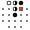

<div align="center">



# Hetzner Cloud Radar

**Know which Hetzner Cloud servers you can actually deploy, before the console says no.**

Live stock for every Hetzner Cloud server type in every datacentre, polled every 20 minutes.
Restock and sold-out alerts straight to your inbox.

[**hetzner.thegoated.dev →**](https://hetzner.thegoated.dev)

[](https://hetzner.thegoated.dev)
[](https://nextjs.org)
[](https://react.dev)
[](https://turso.tech)
[](https://vercel.com)

[Live radar](https://hetzner.thegoated.dev) · [Dispatches](https://hetzner.thegoated.dev/dispatches) · [Methodology](https://hetzner.thegoated.dev/methodology) · [Atom feed](https://hetzner.thegoated.dev/feed.atom)

</div>

---

## Why

Hetzner regularly runs out of popular server types in popular regions. Most people
find out when `hcloud server create` fails. Radar answers one question fast:

> Can I create a CCX33 in Falkenstein right now, or do I need another region?

Radar is independent. It reads the public Hetzner Cloud API and has no affiliation with Hetzner.

## Features

- **Live stock matrix.** Every server family by datacentre (NBG1, FSN1, HEL1, ASH, HIL, SIN).
- **Five honest states.** `available`, `limited`, `sold-out`, `not-offered`, `unknown`. Each one has a glyph and a label, so colour is never the only signal.
- **24-hour cell history.** Click any cell to see when it flipped.
- **Supply trend.** A chart of regional capacity over time.
- **Email dispatches.** Get sold-out and restock alerts, filtered by family and datacentre.
- **Machine-readable.** Use `GET /api/availability`, the Atom feed, or the `/md` page mirrors.
- **Auto-discovery.** New Hetzner server families show up without a deploy.

## How it works

```text
 Vercel Cron (*/20)          Hetzner Cloud API
        │                           │
        ▼                           │
 /api/internal/poll ───────────────►│  GET /v1/server_types
        │
        ▼
     Turso (libSQL)  ── current state, daily flicker, stock events
        │
        ├──► ISR pages (/, /dispatches, /feed.atom), revalidated after each poll
        └──► Resend dispatches on sold-out / restock
```

**State rules**

| Hetzner says | Radar shows |
| --- | --- |
| Location listed, `available: true` | `available` |
| `available` now, but sold out earlier the same UTC day | `limited` |
| Location listed, `available: false` | `sold-out` |
| Tracked location missing from server type | `not-offered` |
| Fetch or parse failed | `unknown` (never a false sold-out) |

A daily cron (`/api/internal/discovery`, 06:00 UTC) finds server families that are
missing from `SERVER_FAMILY_META` and stores them with generic copy. They appear on the
dashboard but don't send email dispatches. To change that, add the family to
`src/lib/server-families.ts`. Config wins over the DB.

## Stack

| | |
| --- | --- |
| Framework | Next.js 16 App Router, React 19 |
| Data | Turso (libSQL), Drizzle ORM + Drizzle Kit |
| Styling | Tailwind CSS v4 |
| Email | Resend Contacts, Segments, Topics |
| Abuse / analytics | Cloudflare Turnstile, PostHog |
| Tooling | pnpm, Biome, Husky, commitlint |
| Hosting | Vercel (Git deploys + Cron) |

## Quickstart

You need Node, pnpm, and the [Turso CLI](https://docs.turso.tech/cli) logged into a
`hetzner-cloud-radar` group with a `main` database.

```bash
pnpm install
cp env.example .env.local   # fill in HETZNER_API_TOKEN, RESEND_*, CRON_SECRET, …
pnpm dev                    # branches a throwaway Turso DB from main, runs next dev
```

`pnpm dev` creates a temporary `hcr-dev-*` branch and destroys it on exit. Branches
older than 24h are pruned automatically.

Trigger a poll or a discovery run locally:

```bash
curl -H "Authorization: Bearer $CRON_SECRET" http://localhost:3000/api/internal/poll
curl -H "Authorization: Bearer $CRON_SECRET" http://localhost:3000/api/internal/discovery
```

Never commit `.env.local` or real tokens.

<details>
<summary><b>Environment variables</b></summary>

See [`env.example`](env.example) for the full list.

| Variable | Purpose |
| --- | --- |
| `TURSO_DATABASE_URL`, `TURSO_AUTH_TOKEN` | Database (set by `pnpm dev` locally) |
| `HETZNER_API_TOKEN` | Read-only Hetzner Cloud token |
| `CRON_SECRET` | Bearer token for `/api/internal/*` |
| `RESEND_API_KEY`, `RESEND_FROM_EMAIL`, `RESEND_MARKETING_SEGMENT_ID` | Subscriber sync and dispatches. The sender must be verified in Resend. |
| `UNSUBSCRIBE_SECRET` | Signs unsubscribe links |
| `NEXT_PUBLIC_TURNSTILE_SITE_KEY`, `TURNSTILE_SECRET_KEY` | Bot protection on subscribe |
| `NEXT_PUBLIC_POSTHOG_PROJECT_TOKEN`, `NEXT_PUBLIC_POSTHOG_HOST` | Analytics (consent-gated) |
| `DISCORD_UNSUBSCRIBE_FEEDBACK_WEBHOOK_URL` | Optional unsubscribe feedback relay |
| `NEXT_PUBLIC_SITE_URL` | Canonical URL, default `https://hetzner.thegoated.dev` |

</details>

<details>
<summary><b>Scripts</b></summary>

| Command | Does |
| --- | --- |
| `pnpm dev` | Dev server on a branched Turso DB |
| `pnpm build` | Production build |
| `pnpm lint` | Biome check |
| `pnpm db:generate` | Generate Drizzle migrations from `src/lib/db/schema.ts` |
| `pnpm db:migrate` | Apply migrations (runs automatically on production builds) |
| `pnpm db:studio` | Drizzle Studio |
| `pnpm families:audit` | Report Hetzner families missing local metadata |

</details>

<details>
<summary><b>Public API</b></summary>

```http
GET /api/availability
GET /api/availability/history
```

`/api/availability` returns the dashboard read model: `families`, `observedAt`,
`observedDate`, `pollCadence`, `topLine`, `events`, `supplyHistory`, `usingFallback`.

```http
POST /api/subscribe
```

Syncs the email and its preferences to Resend. Radar stores no subscriber emails locally.

Public reads send `Cache-Control` with a 20 min fresh TTL, 60 min
stale-while-revalidate, and 24 h stale-if-error. Never cache `/api/subscribe` or
`/api/unsubscribe*`.

</details>

## Project layout

```text
src/app/                 Routes, UI, API handlers
src/app/api/internal/    Cron endpoints (poll, discovery)
src/emails/              Email templates
src/lib/availability/    Hetzner polling + read model
src/lib/db/              Drizzle client + schema
src/lib/marketing/       Resend sync + dispatches
docs/adr/                Architecture decisions
drizzle/                 Generated migrations
```

## Deploy

Push to `main`. Vercel builds, runs migrations on production, and registers the crons
from [`vercel.json`](vercel.json).

<div align="center">
<br>
<sub>Independent project. Not affiliated with Hetzner Online GmbH.</sub>
</div>
